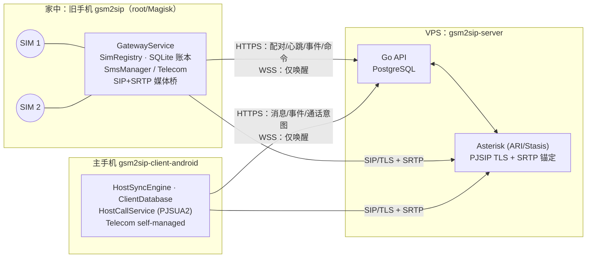

# 三端架构与远程控制链路

更新：2026-10-11。本文是三仓库的总览入口：目标、组件职责、关键数据流、
协议演进方式，以及本轮架构/界面审查的结论与后续优先级。协议细节仍以
[wire addendum](server-wire-addendum.md) 与 [OpenAPI](../openapi/openapi.yaml) 为准。

## 目标

一台已 root（Magisk）的旧 Android 手机插两张 SIM，作为**网关**常驻在家；
普通未 root 的 Android 主手机通过自建**服务器**完全远程地：

- 选择 SIM 1 / SIM 2 发短信，实时收到两张卡的短信；
- 选择 SIM 拨出电话、接听打到任一张卡的来电，双向通话与按键（DTMF）；
- 随时看到旧手机是否在线、电量、每张卡的信号与网络状态，以及失败原因。

## 组件与信任边界

| 组件 | 负责 | 不负责 |
|---|---|---|
| 网关 | 本机 SIM 观测与逐卡确认、指定订阅收发短信、蜂窝通话与音频桥接、心跳与电台遥测 | 不开放任何公网入口；不自行决定路由；未确认的卡不执行任务、不回落默认卡 |
| 服务器 | 身份/配对、`sim_id` 与 revision 权威、短信命令与事件持久化、通话授权与 ARI 编排、多主机广播 | 不保存 ICCID/IMSI；不把 SIP 响应当作数据库确认 |
| 主机 | 会话与本地缓存、三标签界面（电话/短信/设置）、通话 UI 与 Telecom、旧手机状态展示 | 不持有 root、不直接接触 SIM |

WSS 只发 `sync_required`，所有权威数据都走认证 HTTPS，断线后靠游标补齐。

## 关键数据流

**发短信**：主机 `POST /messages`（幂等键 + 选定 `sim_id`/revision）→ 服务器排队命令 →
WSS 唤醒网关 → 网关 claim 命令、先写 SQLite `dispatching` 再调用订阅绑定的 `SmsManager`
→ 分片回执作为事件上传 → 服务器提交后 ACK → 主机经事件游标看到 `submitted/delivered`。
进程在 `dispatching` 后崩溃只会得到 `unknown`，绝不自动重发。

**收短信**：`SMS_RECEIVED` → 网关事务写入事件 → HTTPS 批量上传、逐事件 durable ACK →
主机事件游标同步并按服务器消息 ID 去重通知。

**拨出**：主机 `POST /call-intents` → 主机 PJSUA2 发起 INVITE → Asterisk 校验意图、
剥离客户端 `X-*` 并写入可信 `X-GSM-*` → 网关核对 SIM/revision/账本后用指定
`PhoneAccountHandle` 拨号 → 接通后双向 SRTP 经 Asterisk 锚定。

**来电**：网关按 `PhoneAccountHandle` 识卡、持久化 call_id、向 Asterisk 发 INVITE 并让
蜂窝侧继续振铃 → 服务器为每台在线主机建立候选腿 → 第一台真正接通的主机胜出，
其余显示“其他设备已接听” → 网关此时才接听蜂窝腿。

**旧手机状态（本轮新增）**：网关每约 30 秒心跳上报电量、充电、SIP 注册，以及每张卡的
`service_state`；服务器在响应中声明 `extensions:["sim_radio"]` 后，网关在后续心跳里附带
每卡信号格数、网络制式、运营商与漫游。主机在电话/短信页顶部显示紧凑状态条，设置页显示
完整卡片；心跳超过 120 秒即按离线处理并隐藏过期信号。

## 协议演进规则

服务器对请求 JSON 使用 `DisallowUnknownFields`，这能挡住拼写错误和越权字段，但也意味着
新字段不能直接加到旧服务器能收到的请求里。本轮采用的**扩展协商**模式应作为后续惯例：

1. 服务器在响应里列出它接受的可选扩展（如心跳响应 `extensions`）。
2. 客户端只在当前服务器、当前配对声明过该扩展后才发送新字段。
3. 若服务器之后以 `INVALID_JSON` 拒绝扩展请求（例如回滚），客户端丢弃该请求体、忘记扩展并
   以旧格式重试。

响应侧新增字段始终是可选的，旧客户端忽略即可。

## 本轮审查结论与改动

| 范围 | 发现 | 本轮处理 |
|---|---|---|
| 主机界面 | 已下载旧手机电量/充电/SIP 状态却从未显示；离线时用户只能从失败中猜 | 新增旧手机状态卡（在线/最后在线、电量、通话就绪、每卡信号/制式/漫游/待确认原因） |
| 主机界面 | 拨号按钮被禁用时不说明原因 | 拨号页显示阻断原因（未配对、服务器未配置通话、旧手机离线、卡待确认、revision 变化等）与非阻断提示 |
| 主机界面 | 改为三标签后约 30 处 `statusMessage`（入队、结果未知、离线、SIM 变化）不再显示；部分仍为英文 | 统一以 Snackbar 显示并全部中文化 |
| 主机架构 | `MainActivity` 3 千余行；每次搜索按键都重新读取整张短信表 | 抽出 `SmsThreadIndex`、`CallHistoryCache`、`GatewayStatusPresenter`、`CallReadiness`（均有单测）；短信会话每次渲染只构建一次，按键仅内存过滤 |
| 网关界面 | 配置流程分散；设置页中英混杂；TLS 说明称“音频不加密”与强制 SRTP 矛盾 | 首页新增“完成设置”清单（配对→确认 SIM→后台→可选通话），每步一键跳转；设置分组为中转服务器/SIM/远程通话/短信/高级，并更正文案 |
| 协议 | 心跳缺少每卡电台状态 | `sim_radio` 扩展、迁移 `0011_sim_radio.sql`、OpenAPI/fixture/契约负例与 PostgreSQL 集成测试 |

## 后续优先级

1. **真机验收**（阻塞“完整可用”）：目标旧手机两卡的数字音频采集/注入、DTMF、DSDS
   一卡通话时另一卡来电/短信、24h 熄屏 + 72h 持续运行。没有这一步，通话只能算“已实现未验收”。
2. **离线告警**：服务器在网关心跳过期时向主机推送一次“旧手机离线”事件（现在只能在打开 App
   时看到）。可复用 WSS 唤醒 + 事件流，不需要新通道。
3. **主机来电唤醒**：现有方案依赖常驻 SIP 注册前台服务；GMS 设备应增加 FCM 高优先级唤醒，
   降低耗电并提升 Doze 下来电及时性。
4. **主机架构继续拆分**：把会话/网关/短信状态迁入 `ViewModel` + 仓库层，列表改用
   `RecyclerView`，`MainActivity` 只负责导航与渲染；网关 `MainActivity`/`GatewayService`
   同样按“配置向导 / 状态 / 诊断 / 日志”拆分。
5. **通用能力发现**：把本轮的扩展协商推广为 `GET /v1/capabilities`，覆盖服务器版本、可选字段与
   通话能力，替代各处零散的 `available/reason`。
6. **网关远程运维**：在主机设置中只读展示网关版本、root/Magisk 状态与最近错误，便于不接触旧手机
   就能判断问题；任何远程写操作都必须保持“旧手机本地确认”原则。
