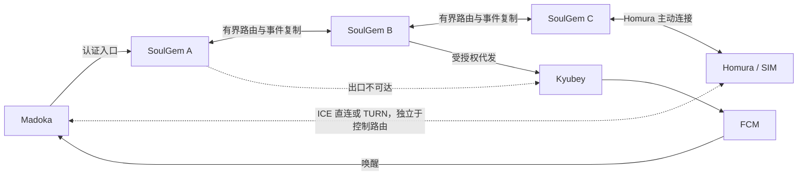

# SoulGem 去中心化 mesh：架构审查与实施计划

> **2026-10-27 范围修订：本文归档为架构参考，原 S0–S6 与附录 F1–F3 不再作为整套待执行计划或发布门槛。** 当前顺序以 [Reception 精简 PLAN](https://github.com/KiriKira/gsm2sip-client-android/blob/2522593e8772a2b6005eb82d8d74aaecaf08c025/docs/reception-v2-PLAN.md)及[mesh 整合决定](https://github.com/KiriKira/gsm2sip-client-android/blob/2522593e8772a2b6005eb82d8d74aaecaf08c025/docs/reception-mesh-decision.md)为准。
>
> R1 合并 S0/S4/F1/F2 的接收优化，复用现有事件/游标、取消短期休眠续约及周期触达证明；出口容错优先 R2a（同密钥/格式/FCM 项目的受信 Kyubey 备用地址），仍需要不同出口时再以 R2b 将 S1 缩为静态受信 peer 的单跳同步推送代发。S2 复制、S3 完整控制委托、S5 媒体目录暂不排期，S6 活跃迁移移出当前路线；单入口代理仅在实际需求出现时独立推进。下文的完整 outbox/receipt、快照/复制机制和广泛测试矩阵均为历史设计，不是本次实现要求。
>
> 实际先覆盖主中继地址故障切受信备用地址，需要时再覆盖 A 出口失败由 B 代发；A 无订阅继续 B/C 是既有行为，新错误码只改善诊断。R2 不承诺 A 宕机业务接管或完整去中心化复制；这些能力需要另立明确需求。单跳代发无法解决手机端 FCM/Doze 限制。

原文日期：2026-10-26。状态：历史三端联合可行性设计，保留源码审查与架构取舍供参考。没有部署新服务，也没有测得新架构的故障恢复或性能结果；正文中的“实施”“验收”按上述新范围解释。

## 1. 结论与审查基线

**可行。建议演进为用户授权的对等节点联邦：独立数据库、可信成员、持久事件同步、按业务授权转发、网关执行裁决。** 手机只需连接一个可达入口，节点可以转送到 Homura 所在出口，也可以帮助其他节点向 Kyubey 投递推送。

本计划与 Madoka 下一版本的耗电优化独立排期，既不阻塞其发布，也不能替代其无 FCM 节电验收。远期项目内先交付跨节点推送代发和历史事件同步，逐步接入控制路由。完整数据库多主复制和活跃通话透明迁移不适合作为第一版承诺。没有固定服务器主节点不代表没有权威：物理 SIM 操作最终由 Homura 裁决；每通电话有明确控制归属；成员与授权有可验证的签发来源。

| 项目 | 本次已核对默认分支快照 |
| --- | --- |
| SoulGem | `60eeaedfc92230fa22da9a2182d794b414aa3dbc` |
| Madoka | `7c252c16328da712f4abcb7d01ec31b21baf43bb`，含推送状态 UI 与完整备份 |
| Homura | `31f65a7d5aa7fbca7df575d73a87fcf3b018b254`，含音频死锁修复、watchdog 与完整备份 |
| Kyubey | `28213b59122936e3b44c7f0a2d41dc8cd43e19f0`，本次通过 GitHub 复核 |

审查对象是源码，不是生产部署拓扑或故障实测。现有 [mesh 设计](mesh.md) 明确各节点独立、无数据库复制、不转发信令；本文是它的下一阶段设计。部分旧架构/roadmap 文档仍写 SIP 或“FCM 未实现”，不能作为当前事实。独立的下一版本 [Madoka 计划](https://github.com/KiriKira/gsm2sip-client-android/blob/docs/madoka-next-release-power/docs/standby-optimization-plan-20261026.md) 以本次新合并代码为基线。

## 2. 当前架构及缺口

当前链路：两部手机分别配对每个节点；Homura 扇出事件/来电，Madoka 探测并选择节点。每个 SoulGem 有自己的 PostgreSQL、owner/device/session、事件游标、RTC 控制状态和 TURN 配置。节点之间没有 peer RPC、成员协议或复制日志。

| 优先级 | 证据 | 结论与后果 |
| --- | --- | --- |
| P0 | `internal/httpapi/rtc_control.go:291`：client capability 最近 90s 内刷新；incoming 默认 25s 窗口 | Madoka 不能直接停续租进入深睡；要新增可休眠来电资格 |
| P0 | `internal/httpapi/rtc_control.go:732`：活跃控制参与者 20s 租约；`rtc_media.go` 检查本地精确 bearer session 和本地 call binding | 复制 call 行或转发 bearer 不足以迁移控制权；需新跨节点授权和 fencing 契约 |
| P1 | `internal/httpapi/push.go:123`：每秒扫描 endpoint cursor，最多 100 项；发送循环串行，每项最长 10s | 大量慢端点可使一批接近 1000s；后面的来电可能超过 25s；没有来电独立优先队列 |
| P1 | 同上：读 batch 后没有任务 claim/租约，API 每个进程的 `RunBackground()` 都运行 runPush | 多 API 副本共用一个 DB 时可能重复投递；扩成 mesh 前先解决本节点并发领取 |
| P1 | 发送成功推进 pushed cursor；`putPushEndpoint` 通过 `check` 登记；Kyubey `validate_only=true` | provider 接受不等于手机收到，registered 不等于休眠可达 |
| P1 | `internal/push/endpoint.go` 发 TTL=60；Kyubey `src/fcm.js` 固定 android.ttl=60s | 缺少按呼叫截止时间计算 TTL 的语义；节点间重试不能让过期来电重新响铃 |
| P1 | `migrations/0012_mesh_identity.sql`、`0015_join_codes_push.sql` | 有 gateway install_id 和本地 push endpoint，没有 federation/node identity、跨节点授权映射或转发记录 |
| P1 | `internal/httpapi/event_feed.go`、`rtc_control.go` | cursor、revision、device_id/owner_id 都在节点范围内；不能直接按 UUID/游标大小跨库合并 |
| P2 | `wake_websocket.go`：每连接每秒查询变化，20s Ping；Madoka 另有 25s Ping 和 15～30s 节点探测 | 手机和服务端都有随连接/节点数放大的重复工作 |
| P2 | `rtc_media.go` 的 STUN/TURN URLs 和共享密钥来自本节点环境配置 | 没有整个 mesh 的媒体质量测量/候选中继目录；API RTT 不代表音频路径质量 |

可以复用：Go/SQL 事务、durable ACK、设备鉴权、全局 message_id/call_id、Homura SQLite dispatch ledger 和 winner CAS、客户端跨节点去重、native WebRTC/ICE。必须保留“unknown 不重拨/不重发”和真实蜂窝 END 才释放占用的约束。

## 3. 目标拓扑与故障边界

图中 A/B/C 是一次业务的角色，任何受信任节点都可承担，不设固定中心调度器。初版控制路径最多两个服务器边（如 A→B→C），推送代发最多一个 peer 跳；候选数量和复制扇出均有上限。

| 能力 / 故障 | 可行性与边界 |
| --- | --- |
| A→Kyubey DNS/TCP/TLS 超时、地区/出口限制，B 可达 | 可以 A→B→Kyubey；每次仍执行 B 本地出站策略与鉴权 |
| Kyubey 凭证错误、FCM 项目错误或 token 失效 | 换 SoulGem 出口无效；修复 relay/重新登记端点；不无限重试 |
| FCM 到手机不通、无 GMS、系统限制 | 换 SoulGem 出口无效；需要经验证的其他推送提供方或兼容监听模式 |
| A 已宕机 | B 只能处理故障前已复制/委托的任务；不能代发 A 未持久化或未复制的信息 |
| A 已接受请求但响应丢失 | 通过全局 operation ID 和最终 Homura 账本去重；跨网络不承诺 exactly-once delivery |
| Madoka 只能到 A，Homura 只能到 C，A↔C 或 A↔B↔C 可达 | 可经 mesh 建立控制路径，但还需独立验证两端媒体可达性 |
| 完全网络分区 | 各分区可读取已有副本、积压允许的任务；没有 Homura 可达路径就不能执行 SIM 操作 |
| 原控制节点在通话中丢失 | 首版保持现有租约/unknown/终止语义，不保证无缝续话；透明迁移是后续单独阶段 |

Kyubey 和 FCM 仍是推送链路的共同依赖。多 Kyubey 只有使用手机已登记且凭证正确的独立 endpoint 才有帮助；不能把一个 sealed endpoint 的 hostname 任意替换。无 GMS 支持另列提供方适配，不包装成 mesh 已解决的问题。

## 4. 信任、身份与成员管理

第一版面向同一用户/管理员明确授权的少量私有节点，建议先验证 3～10 节点；不实现开放公共节点自动加入。

1. 引入 `federation_id`、稳定 `node_id`、节点签名公钥、key epoch、协议范围、可达地址和 capability。node_id 不依赖可变 IP。peer 通道用 mTLS，转发与复制对象附来源签名及 audience。
2. 通过一次性受限邀请/离线指纹确认加入；邀请不等于运行时中心。多个种子仅用于发现；节点持久保存已验证成员、从多个 peer 交换签名变更。种子关闭后已建立联邦继续工作。
3. 成员变更由联邦管理密钥签发，支持轮换和撤销；后续可引入多签管理。管理密钥是授权根而非必须常在线的服务。网络分区中无法保证即时全局撤销，使用短期授权到期界定风险，新高权限操作在授权过期后拒绝。
4. 身份映射表绑定 `(federation_id, global_subject_id, role)` 到各节点的 owner/device ID；由用户配对证明/授权凭证建立。仅匹配 install_id 不构成身份认证，不能让两个无关 owner 因同一个 install_id 自动合并。
5. 节点只能同步获授权 owner/install 的数据。peer 资格不自动授予所有租户权限；转发令牌限定设备、动作、call/message、接收节点、过期时间与授权 epoch，不携带长期手机 refresh token。
6. 接收节点检查签名、受众、权限、nonce/operation_id、deadline、成员/设备撤销代际、请求体哈希。每个节点独立限流、限制正文大小与路由跳数；不能作为任意 URL 的开放代理。
7. 备份/克隆节点恢复时换 incarnation/epoch 并隔离旧 outbox 和执行任务，先补同步/撤销信息，再允许业务；同一 node_id 两个活实例须隔离冲突。手机备份恢复也重新证明端点与设备身份。

现有 `SECRETS_ENCRYPTION_KEY`、数据库凭据、session refresh token、FCM 私钥、TURN shared secret 不做全网复制。endpoint 本身是发送能力，应加密存储、只委托给获授权代发节点，不写日志/普通 gossip。

## 5. 同步模型：复制业务事实，控制副作用归属

### 5.1 建议的对象与冲突规则

| 对象 | 权威来源 | 同步与冲突处理 |
| --- | --- | --- |
| 设备/节点授权与撤销 | 授权签发者 | 有签名 epoch；撤销 tombstone 压过旧授权，拒绝同 epoch 不同内容 |
| 入站短信、SIM 观测、蜂窝终态 | Homura 安装实例 | 稳定 event_id、安装 epoch、源序号；同 ID 不同内容隔离，不以最后到达覆盖 |
| 出站请求 | Madoka 设备的 operation/message ID | 内容哈希绑定 SIM/收件人/正文，重复同内容返回同结果；冲突拒绝 |
| 出站执行事实、来电 winner | Homura 持久执行账本 | 唯一派发与 winner CAS；节点无权凭超时推断可再次执行 |
| 通话控制快照 | 每通 call 的 control owner + epoch | 只接受当前 owner epoch 的 revision；终态事实持久同步，活跃镜像不能当执行授权 |
| 在线状态、链路质量、路由 | 观测者 | 带时间、TTL、序号，过期即未知；不覆盖授权或执行事实 |
| 用户偏好 | 指定设备/用户签名版本 | 简单字段可按明确版本策略合并，冲突展示；安全字段不做任意 LWW |

**禁止把整个 PostgreSQL 做无约束双向逻辑复制。** 本地 session 轮换、command claim、SIM mapping_revision、call occupancy 等具有本地事务前提。复制事实后通过幂等投影生成本地读模型；远端 terminal fact 也不能直接触发 modem 命令。

### 5.2 事件信封与可靠同步

建议信封：`federation_id, origin_node_id, origin_epoch, origin_seq, event_id, object_id, object_type, author_subject, author_epoch, object_revision, dependencies, payload_hash, schema_version, created_at, expires_at?, signature`。Homura 的业务 event_id 跨节点保持相同；各入口可有不同 replication event ID，投影仍按业务 ID 去重。

- 同一事务提交本地业务事实与 replication outbox。接收方在一个事务中完成 inbox 去重、校验、落盘和投影，提交后 ACK；发送方收到 durable ACK 后更新 peer 水位。
- 维护每个 origin/epoch 的**连续**水位与缺口集合，不能把见过的最大序号当完整水位；定期 anti-entropy 比较摘要并补拉。乱序缺依赖时持久暂存，超过保留窗口使用签名快照 + 后续日志重建。
- 日志保留由授权 peer 的 ACK/最大离线窗口控制。离线太久的 peer 必须完整重新引导；不能为一个永久离线节点无限保留正文。撤销 tombstone 至少覆盖旧授权寿命和重引导窗口，快照带当前撤销代际。
- 通知与复制分开：历史导入、修复回放默认不唤醒手机；新业务才生成或合并 wake intent。同一逻辑短信在三个副本出现只通知一次。
- 原有 API cursor 保持节点作用域；新增 mesh feed 用 federation/origin/epoch 水位或服务端签名的 opaque checkpoint。切换节点不能把 A 的整数 cursor 交给 B。
- 短信正文仅复制给显式授权的存储节点，定义保留/删除政策；第一版不声称端到端加密。删除作为带版本 tombstone 同步，不能被离线旧副本复活。

### 5.3 持久性与分区选择

提供明确的 ACK 等级：`local_committed`（本节点落盘）和 `replicated`（至少一个独立 peer 已落盘，初始目标 RF=2）。两者不是执行成功。一般历史可异步复制；需要抗入口丢盘的请求使用 replicated，超时返回 pending/不足副本，不能谎报已复制。

RF=2 是耐久副本数，不是全局共识或互斥锁。分区时允许本地积压并公开复制不足；物理执行仍需有效授权、可达 Homura 与其持久去重。对未复制便永久丢盘的本地 ACK 数据存在 RPO 风险，必须在 API/运维文档说明。节点时钟不能决定谁赢得接听，截止时间使用保守偏差预算，超出允许时钟偏差的节点退出实时路由。

## 6. 跨节点推送代发

### 6.1 先修本地调度 S0

将 cursor 扫描升级为持久 `push_jobs`/outbox（仍可保留扫描做补漏）：按 `(origin, recipient, endpoint_generation, wake_id)` 唯一；保存 scope、deadline、状态、attempt、next_attempt、claim_owner/lease_until、accepted_at、received_at。

任务短事务 `FOR UPDATE SKIP LOCKED` 领取、租约到期重领，网络 I/O 在事务外；完成更新用 claim token 与 endpoint generation 做 CAS。多 API 副本不会同时正常领取同一任务，崩溃与响应丢失仍可能重复，必须允许幂等重投。

来电独立优先队列、有界并发、公平调度、总超时受剩余窗口限制；单端点失败不阻塞其他设备。调用者在有效 25s 窗口内预留 fallback 和手机拉取/响铃时间，不能先耗尽 10s × 多节点再代发。HTTP Retry-After 与抖动退避不能超过 deadline；过期 call wake 停止发送，历史短信补同步单独保留。

### 6.2 代发协议 S1/S4

建议内部 API `POST /mesh/v1/push/forward`，需 mTLS + scope 授权。请求含 signed origin、recipient binding、endpoint generation、授权的 endpoint 引用/加密负载、wake_id、scopes、absolute deadline、hop_limit、visited_nodes、原始 payload hash。第一版只允许一跳代发，B 不再找 C。

顺序：A 持久化 job → 优先可用出口；A→Kyubey 局部失败/健康熔断时交 B → B 落盘 ACK → B 检查剩余 TTL 与授权后投 Kyubey → 返回 provider accepted 状态 → Madoka 收到后认证 receipt。

- A/B 保留同一个 wake_id、origin 和原节点 device_id。B 不能替换成 B 的本地 device_id。当前 Madoka v1 按已配对 device_id 识别来源；如果 A 的业务数据不可读取，单纯代发仅能唤醒，完整补查还依赖 S2/S3。
- A 故障时 B 继续已持久委托；若要 B 接管 A 未开始的任务，需在故障前复制任务/授权。不能把 peer 可达误认为任务已复制。
- 普通情况下串行有限出口切换；确有时延需求再做有预算的 hedge，禁止全网广播每次来电。来源失联或双重接管允许 at-least-once，接收端以 wake_id 去重。
- 联邦 dedup 无法阻止所有分区重复。Kyubey 若增加去重，必须以强一致的原子 claim/outbox/租约实现；不能用最终一致 KV 做锁，也不能先标记“成功”再发送。响应丢失仍按至少一次处理。
- v1 代发可以先提供出站网络容错，但不具备跨中继去重、真实回执或按呼叫 deadline TTL 的完整保证；发布说明必须区分。

### 6.3 Kyubey v2 与真实触达

新增版本化字段 `wake_id, origin_node_id, scopes, expires_at, endpoint_generation`，严格大小和类型校验，FCM data 使用字符串；不推送正文/号码。把剩余 TTL 写入 android.ttl，不能只设置 HTTP TTL header。对 call 设置合理短 TTL，sms 与 call 不共享会吞掉独立来电的 collapse key。

登记 `check` 继续只验证凭证；增加用户主动、频率受限的 nonce 测试及手机认证回执。区分 `queued → delegated → provider_accepted → received → fetched → presented`；未收到 receipt 可能是 ACK 丢失，不能无限补发或断言未响铃。

EndpointGone/凭证错误单独处理；保留原有重定向禁用、连接时 IP 检查和私网策略。局部 403/WAF 与 endpoint 永久失效分类应可诊断，不能让另一个节点撤销用户全部有效端点。端点换代使旧队列失效，撤销同步至受托方。

## 7. Madoka→Homura 的路径选择

### 7.1 控制平面

把一次路径拆成 `Madoka→ingress`、零到两段 `peer→peer`、`egress→Homura`。Homura 主动维护出口连接，无须公网入站；出口广播短 TTL 的网关 presence 与支持的动作。Madoka 提供本机入口观测，Homura/出口提供它们的链路观测，peer 测量节点间 RTT/失败率/队列延迟。

先过滤权限、协议、presence TTL、SIM、剩余 deadline、跳数、可达性，再对候选计算近似代价：

`cost = sum(各边近期 RTT_EWMA) + 排队代价 + 失败率惩罚 + 过期测量惩罚 + 用户策略代价`

RTT 求和仅用于排序，不能当精确单向延迟。值来自真实请求并有有界后台探测，不能让 Madoka 为测量唤醒所有节点。链路质量按网络类型/变更代际隔离；未知不等于最快。稳定窗口、切换收益阈值与最小驻留时间避免抖动；初始参数在实验配置中，按数据调整。

建议先用**有限候选的源路由**：入口带 route_id、短 TTL、visited list/hop limit，目标绑定 Homura installation。每跳验证下一跳和业务授权，拒绝回环；以后节点规模扩大再决定是否需要更复杂的 gossip/link-state 算法。用户“固定节点”策略优先于自动选优，硬故障才按其允许范围降级。

### 7.2 跨节点控制授权和执行安全

引入显式 mesh Principal 与 authorizer，承载来源设备证明和委托链；不把 A 的 bearer token 交给 C 直接当本地 session 使用。旧 v1 authorizer 原样隔离，逐步迁移，不能通过关闭当前 session 检查获得可用性。

每个请求包含全局 operation_id、body hash、call/message ID、install/SIM identity、授权 epoch、deadline；本地 mapping_revision 映射到 Homura 已确认的绑定版本，不能跨节点复用整数版本。转发 ACK 与执行 ACK 分开。

新通话选定 control owner，所有相关节点代理至它并固定 owner epoch。Homura 在持久账本中维护每个 call 的 owner epoch、唯一 dispatch 与 winner，旧 epoch 的 start/answer/dispatch 拒绝。网络分区中不能靠两个节点各自超时升主；owner 变更必须有 Homura 持久签发/确认的新 epoch，并同时验证授权与未发生不确定副作用。

初版只允许未派发、无活跃媒体的安全重选；活跃控制 owner 故障沿用 unknown/结束与真实 END 确认。若以后要求活跃迁移，需要迁移 SDP/ICE generation、媒体授权与租约、操作去重和双端确认，作为独立项目验收。

### 7.3 音频平面

音频优先 ICE 直连，失败时使用候选 TURN。控制路由 A→B→C 不意味着音频也经过三个应用服务器；不自行增加逐节点音频转发链。

建立经授权的 TURN 能力目录（区域、URL、传输协议、容量、健康、有效期），由各 TURN 所属节点签发短期凭据，不共享永久 secret。只向两端提供少量候选，ICE 实际连通检查决定可用 pair；用 selected pair RTT、丢包、jitter、建立耗时评价结果，不能仅按地理距离或 HTTP ping 认定“最优”。

首版对新通话改善候选选择；进行中只允许现有安全媒体恢复。跨 TURN 切换通常涉及 ICE restart，不能承诺迁移既有 allocation。TURN 端口、防火墙、双向音频、移动网络和 VPN 分别验收。“最优”定义为当前授权和可观测候选中的较优路径，不承诺全网数学最优。

## 8. 远期协同收益：推送休眠（不属下一版 Madoka 范围）

S4 引入 `rtc_sleep_v1`：在线 90s capability 与长期、可撤销的 sleep subscription 分离；休眠订阅包含 opt-in、授权/端点代际、有效期与真实接收证明。来电候选可以是休眠订阅者，只有收到提示、认证拉取后才进入当前活跃控制租约。

休眠订阅不得无限有效，也不能依赖精确 Android 定时器续租。返回有效期/维护窗口，由系统机会性维护；过期公开降级，不能静默认为仍可接听。已关闭接听或撤销的设备不再是候选；混合旧节点保留兼容监听，不擅自全局释放手机锁。

mesh 服务器聚合健康与事件，客户端维持一个入口和有限备选；待机不再 O(N) 查询每个节点。WSS 与数据库唤醒可用本地提交后通知/PG LISTEN-NOTIFY 降低轮询，但通知只作提示，durable outbox 和低频补扫仍是真相来源；丢失 notify 不丢事件。

## 9. 数据结构、协议和交付顺序

以下名称是建议，不是已有表或可调用接口。

三端与中继的职责必须一起冻结协议，但各阶段独立交付：

| 项目 | 远期改动责任 |
| --- | --- |
| SoulGem | 成员/授权、事件复制、任务代发、presence/路由、控制归属、睡眠订阅和 TURN 目录 |
| Madoka | 联邦身份与单入口、来源识别/事件去重、路由观测、wake v2/回执、远期休眠状态机；区别于下一版客户端节电 |
| Homura | 安装签名身份与 epoch、出口连接/presence、稳定事件源序号、跨节点授权验证、持久 owner fencing/winner/dispatch；确认副本耐久后逐步减少逐节点扇出 |
| Kyubey | v2 schema、按剩余窗口 TTL、错误分层、可选持久幂等任务；服务器换出口本身不需获取 FCM 私钥 |

| 阶段 | 修改与交付 | 验收门槛 |
| --- | --- | --- |
| S0 本地可靠性 | `push_jobs`、receipt/endpoint generation；修改 `push.go`/`endpoint.go`，短事务 claim、有界并发、来电优先、deadline、状态指标 | 多 API 副本不正常重复领取；慢 endpoint 不阻塞其他来电；进程重启可恢复；旧手机兼容 |
| S1 联邦基础 + 代发 | 新 `internal/mesh`；`mesh_members`、`mesh_bindings`、`mesh_grants`、`mesh_forward_jobs`；admin invite/join/revoke、peer auth/hello/push-forward | A 出口断开而 B 可达时完成代发；超时有界、禁止环路/越权；节点退出可撤销 |
| S2 事件复制 | `mesh_event_log/outbox/inbox/peer_offsets/tombstones`；digest/pull/ack/snapshot；SMS/历史读模型投影 | 分区/重启/乱序/丢 ACK 后收敛；冲突隔离；历史导入不重通知、不执行旧命令 |
| S3 控制路由 | `mesh_presence/link_metrics/routes`、显式 delegated Principal；Homura binding/owner epoch；route request/operation | 手机分别只连接不同节点也能建立新业务；物理短信/拨号最多执行一次；跨 owner 拒绝 |
| S4 推送休眠 | `sleep_subscriptions`、wake v2/receipt；Kyubey v2；客户端远期 F1/F2（附录） | 超过 90s 深睡仍可呼入；已撤销不响、过期不响；真机耗电和随机来电验证 |
| S5 媒体路径 | TURN 目录、按需短凭据、ICE candidate 观测；Madoka/Homura 媒体诊断 | 双向实际音频通过；HTTP 快而 TURN 差时能识别；不迁移进行中业务 owner |
| S6 可选后续 | 活跃 owner/媒体迁移、更大规模拓扑、额外推送提供方 | 独立设计与故障验收，不计入首版完成条件 |

依赖：S1 的代发建立在 S0；S2/S3 依赖 S1 身份/授权；S4 单节点版本只依赖 S0 + 新契约，可与 S1～S3 分别排期；所有 S 阶段属于远期项目。完整 mesh 休眠再接入 S2/S3。S5 在稳定控制路由后推进。

OpenAPI 与 fixture 同时版本化；新增 capability 建议 `mesh_federation_v1`、`mesh_events_v1`、`mesh_forward_v1`、`push_wake_v2`、`rtc_sleep_v1`，分别协商，不用一个 mesh=true 表示全部完成。数据库用扩展式迁移，旧数据显式 backfill 来源和 scope，无法证明身份的记录不自动联邦化。

远期项目启动后的第一轮推荐范围：**S0 + S1 的三节点代发 PoC**，冻结 S4 契约但不阻塞其他工作；验收后再替换手机扇出为 S2 复制。Madoka 下一版本的 N1～N4 独立实施、独立验收，使用现有 SoulGem/Homura 即可。

## 10. 验证矩阵与发布门槛

实施时使用三个独立 PostgreSQL 的真实节点，另加“同节点两个 API 副本”场景；用网络故障注入控制 A↔B、A→Kyubey、B→Kyubey、两部手机入口分别可达性。不能用三个 API 共享一个数据库的测试冒充去中心化 mesh。

| 场景 | 必须观察到的行为 |
| --- | --- |
| A 不能访问 Kyubey，B 能，双方 peer 正常 | call 在截止前经 B 提交；origin/wake_id 不变；A 恢复不重复响铃 |
| 全部节点到 Kyubey 失败 / Kyubey 到 FCM 失败 | 有界重试、明确分层故障，无转发风暴；不宣称已送达 |
| provider accepted 后丢响应、receipt 丢失 | 可重投且业务去重，不重拨、不把一次 SMS 提醒三次 |
| 来源节点在落盘前/后、复制前/后崩溃 | 按 ACK 等级明确数据是否可恢复，不隐瞒 local_committed 的 RPO |
| peer 分区后乱序补齐、旧快照加入 | 缺口修复、最终读模型收敛，撤销/终态不被旧记录覆盖 |
| 两分区同时 start/accept | Homura CAS/fencing 只授权一次副作用，旧 epoch 被拒绝 |
| Madoka→A、Homura→C，双方不能直达对方入口 | 控制经授权 peer 成功；再独立验证 ICE/音频，不能仅看 API 200 |
| owner/device ID 碰撞、恶意 peer 请求其他租户 | 绑定和 audience 校验拒绝，不因 install_id 相同获得访问 |
| 备份克隆、旧 key/endpoint epoch 回归 | 隔离并重新引导，过期委托不能恢复发送 |
| 100 个慢端点 + 一个新来电 | 新来电不排在全部超时之后；报告 deadline miss 和排队 P95 |
| 深度 Doze/弱网/FCM 降级/无 GMS | 记录真实唤醒边界与降级模式，无虚假“必达”结论 |
| 节点恢复/路由质量轻微抖动 | 不频繁切换、不迁移正在通话；用户策略有效 |

建议实验门槛（需测量后调整）：健康三节点 LAN/受控 RTT 下普通事件复制 P95≤2s；已知本地出口故障后代发增加的排队/选择开销 P95≤2s，不含不受控的 FCM 设备投递时间；所有测试无重复物理副作用和跨租户泄漏。广域网分别报告 RTT/丢包条件，不能把该门槛泛化成所有网络 SLA。

来电每个关键真机场景至少 30 次随机触发、样本无漏接且在有效窗口内展示；报告 P50/P95/max 与失败分层。性能记录 CPU/DB 查询数、连接数、outbox 深度/最老年龄、复制 lag/gaps、路由变更、deadline miss、forward 次数、实际 receipt 延迟。标签限定枚举或匿名范围，避免 token/endpoint/号码等敏感高基数日志。

发布：先服务端兼容 capability 和只读 shadow 复制，再允许受控租户代发；验证稳定后启用新路由，最后手机休眠灰度。每阶段独立开关；停用 mesh 路由时排空/隔离委托，保持原操作 ID 与 Homura 账本，不能重新生成任务。旧手机扇出与新复制并存期间去重必须先完成；在副本持久性达标前不删除手机原有上传副本。

## 11. 仍需在 PoC 阶段回答的问题

- 实际节点数、地域、NAT/私网互通条件与信任边界；初版按少量同一管理员可信节点设计。私人 LAN 地址是否被其他 peer 访问需要明确部署配置。
- 副本放置、保留期与正文可存储地域；RF=2 只覆盖一个副本失效，不能覆盖所有节点同时丢盘。
- Homura 稳定签名身份/epoch 的生成与备份克隆检测；不能把现有可恢复 install_id 单独当不可克隆安全身份。
- 休眠订阅有效期、receipt 观察窗口、失败阈值与推送提供方覆盖；用实际 Android 设备和目标厂商策略确定。
- 活跃控制节点失效时是否接受通话终止；若要求不中断，S6 的授权/媒体迁移预算必须单独投入。

这些问题不阻塞 S0 和协议 PoC；在扩大部署与承诺可用性前必须给出具体配置和数据。

## 12. 固定源码证据

服务端本文相对路径基于 [SoulGem 快照](https://github.com/KiriKira/gsm2sip-server/tree/60eeaedfc92230fa22da9a2182d794b414aa3dbc)。关键入口：

- [现有 mesh 边界](https://github.com/KiriKira/gsm2sip-server/blob/60eeaedfc92230fa22da9a2182d794b414aa3dbc/docs/mesh.md)、[push 调度与登记](https://github.com/KiriKira/gsm2sip-server/blob/60eeaedfc92230fa22da9a2182d794b414aa3dbc/internal/httpapi/push.go)、[endpoint 安全和发送](https://github.com/KiriKira/gsm2sip-server/blob/60eeaedfc92230fa22da9a2182d794b414aa3dbc/internal/push/endpoint.go)。
- [RTC 候选/操作/租约](https://github.com/KiriKira/gsm2sip-server/blob/60eeaedfc92230fa22da9a2182d794b414aa3dbc/internal/httpapi/rtc_control.go)、[媒体精确 session 授权](https://github.com/KiriKira/gsm2sip-server/blob/60eeaedfc92230fa22da9a2182d794b414aa3dbc/internal/httpapi/rtc_media.go)、[节点内事件流](https://github.com/KiriKira/gsm2sip-server/blob/60eeaedfc92230fa22da9a2182d794b414aa3dbc/internal/httpapi/event_feed.go)。
- [Madoka 节点选择](https://github.com/KiriKira/gsm2sip-client-android/blob/7c252c16328da712f4abcb7d01ec31b21baf43bb/app/src/main/java/com/callagent/host/mesh/NodeSelectionPolicy.kt)、[推送来源匹配](https://github.com/KiriKira/gsm2sip-client-android/blob/7c252c16328da712f4abcb7d01ec31b21baf43bb/app/src/main/java/com/callagent/host/push/PushWake.kt)。
- [Homura winner CAS 调用](https://github.com/KiriKira/gsm2sip/blob/31f65a7d5aa7fbca7df575d73a87fcf3b018b254/app/src/main/java/com/callagent/gateway/bridge/CallOrchestrator.kt)、[Homura 多节点控制](https://github.com/KiriKira/gsm2sip/blob/31f65a7d5aa7fbca7df575d73a87fcf3b018b254/app/src/main/java/com/callagent/gateway/rtc/GatewayCallControl.kt)。
- [Kyubey v1 字段与 validate_only](https://github.com/KiriKira/Kyubey/blob/28213b59122936e3b44c7f0a2d41dc8cd43e19f0/src/relay.js)、[固定 TTL 与 FCM 错误分类](https://github.com/KiriKira/Kyubey/blob/28213b59122936e3b44c7f0a2d41dc8cd43e19f0/src/fcm.js)。

## 附录：远期客户端协同改造（从下一版 Madoka 计划移出）

本附录仅在三端远期项目排期时实施，不属于下一版 Madoka 的发布承诺。

### F1：跨端协议，让休眠设备有来电资格

与服务端计划 S0、S4 协同；可以先部署在单节点，不依赖 S2/S3 的完整 mesh。

- 新能力名建议 `push_wake_v2`、`rtc_sleep_v1`，字段与版本进入 OpenAPI/fixture，旧客户端仍走 v1。
- 候选资格分为在线租约和可休眠订阅。订阅关联设备授权代际、接听 opt-in、端点代际、有效期、最近真实到达证明；有效期不绑 90s 在线心跳，具体期限由服务端策略返回并实测。
- Wake v2 最小字段：`wake_id`、`origin_node_id`、来源配对设备标识、`scopes`、`expires_at`、`endpoint_generation`。不携带电话号码或短信内容；任何业务状态仍认证拉取。Android FCM data 值使用字符串编码。
- 来电 TTL 取剩余振铃窗口，Kyubey 必须将它写入 FCM android.ttl；当前 v1 固定 60s 不能满足此语义。过期提示只允许补历史，不重新响铃。
- 用认证回执区分中继 accepted、手机 received、认证拉取 fetched、实际通知 presented。回执允许合并、重试，不能让成功显示的通知因回执失败重复显示。
- v1 `call` 提示可能同时覆盖短信，继续双路拉取；v2 才按 scopes 定向处理。重复和乱序提示按 wake_id/对象状态去重。
- mesh 代发保留原节点身份。只换发送出口不等于换业务来源；节点 B 代发 A 的消息不能拿 B 的 device_id 冒充 A。

完成条件：睡眠超过 90s 的受授权设备仍是候选；端点换代、撤销、关闭接听、过期来电不会误响。FCM 降级按实际 priority 决定 Android 启动权限，不靠原始 priority 绕过限制。

### F2：显式监听状态机与锁所有权

| 状态 | 网络和调度 | 锁策略 |
| --- | --- | --- |
| Disabled | 撤销订阅/能力，取消排队工作 | 释放监听锁；用户停止后旧回调不能复活 |
| LegacyListening | v1 兼容轮询与必要续租，展示耗电模式 | 保留兼容模式必要信令锁；下一版客户端优化独立交付 |
| PushSleeping | v2 订阅有效、真实链路验收通过、无通话；停止空闲 RTC 轮询和自有 WSS 心跳 | 不持有空闲信令锁；非实时维护由系统批处理 |
| WakeFetching | 认证拉取、检查截止时间和当前状态；处理节点代发来源 | 有所有者的短锁，预算受剩余来电时间限制；任务结束及时释放 |
| Ringing / InCall | 活跃通话控制与媒体，维持现有业务租约 | 独立通话锁，不能被一次 fetch 的 finally 提前释放 |
| Recovering | 已知失败、切网、过期订阅时恢复资格和必要轮询 | 有界恢复；无网络不无限持锁；必要时回到兼容模式 |

进入 PushSleeping 的门槛：该接听范围内所有承担职责的节点支持协议或已通过 mesh 聚合到有效入口、端点/订阅有效、实际触达验证完成、Android 通知和后台条件符合、无进行中通话。混合节点显式展示逐节点模式；不能因为一个节点成功就全局休眠。

切入休眠先持久化服务器订阅，再停旧续租和释放锁；切回先建立旧在线资格，再撤销休眠订阅。进程死亡、重复 FCM、服务销毁、网络切换、节点切换、用户停止、恢复备份都有代际检查和取消路径。

手机已经深睡且 FCM 丢失时，客户端无法及时获知丢失并立即回退。服务端可做有界代发/其他已验证通道，但不宣称解决所有共同故障。非实时 JobScheduler/WorkManager 维护不能保证秒级呼入；低优先级 FCM 不能保证在 25s 内响铃。

### F3：接入服务器 mesh，降低手机端 O(N) 维护

- 稳态连接一个可达 ingress，保留少量候选入口；服务器返回有时效、签名和代际的网关可达路由与摘要，不再要求 Madoka 定时查询所有节点的每项状态。
- 用户节点优先级仍是策略输入；推荐路径根据 Madoka→入口、节点间、出口→Homura 的实际指标，不能拿一次 `/capabilities` RTT 代表端到端质量。
- 先仅对新通话/空闲切换选择入口和控制路径。活跃通话锁定控制归属，恢复高优先级节点不抢走通话。
- 音频由 ICE 选直连或 TURN；使用已建立通话的 RTT、丢包、jitter 与 selected candidate pair 评价媒体质量。控制路径最短不代表音频路径最优。
- 多节点重复投递改为一个逻辑事件；按 federation + origin/event/object ID 去重，节点内 cursor 仍隔离，撤销/冲突/乱序不能被旧状态覆盖。
- 备份恢复必须清空路由新鲜度、端点代际证明和休眠订阅状态；重新登记。保留已有短信与通话历史的去重语义。
